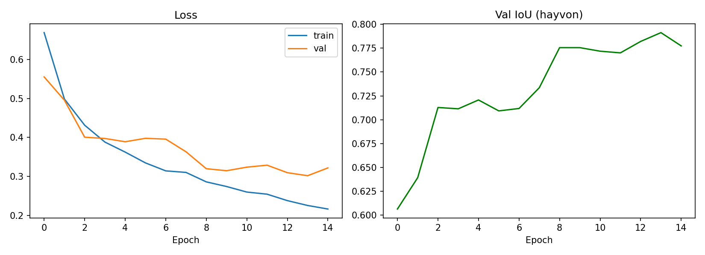
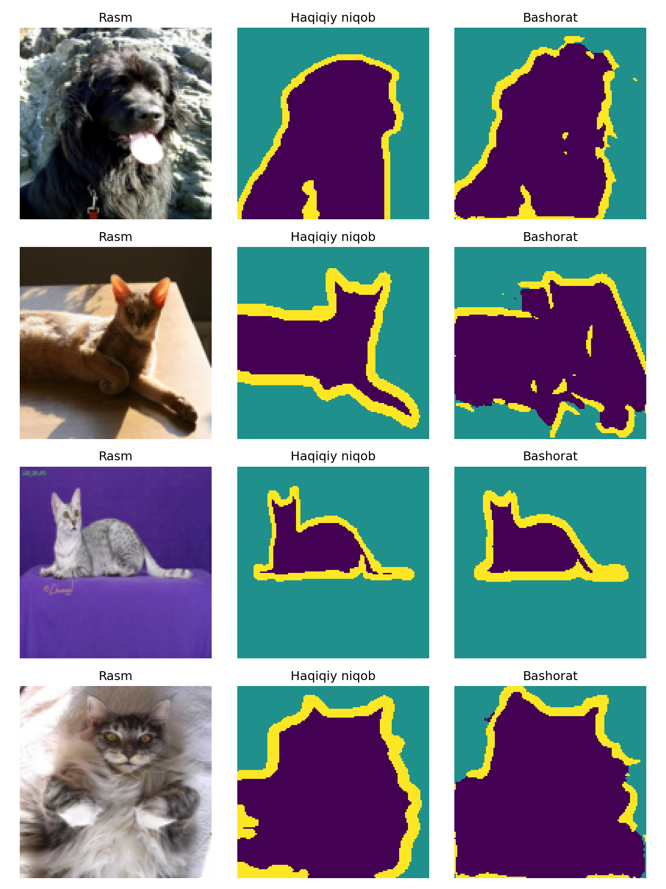

# U-Net járdeminde haywan súwretin fonnan segmentaciyalaw

Student: Kutibaev Erkinbay Kamalbaevich

## Dataset
The Oxford-IIIT Pet Dataset: 37 tuqım, 3680 trainval súwret,
3 klasslı trimap niqab (haywan, fon, shegara).
Siltеme: https://www.kaggle.com/datasets/tanlikesmath/the-oxfordiiit-pet-dataset

## Model
U-Net (4 encoder/decoder blogı, skip-connection), PyTorch.
Súwret ólshemi 128x128, loss: CrossEntropy, optimizer: Adam (lr=1e-3),
15 epoch, Google Colab T4 GPU.

## Nátiyje
- Eń jaqsı val IoU (haywan klassı): 0.791
- Jeńil overfitting: val loss 0.3 átirapında toqtap qaldı

## Isletiw
Notebook'ti Google Colab'ta ashıń (Runtime: T4 GPU) hám katakshalardı izbe-iz islетiń.
